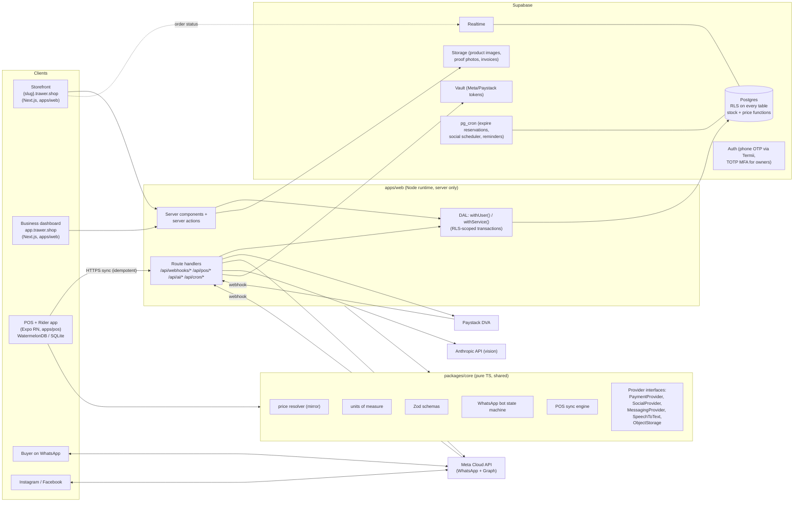
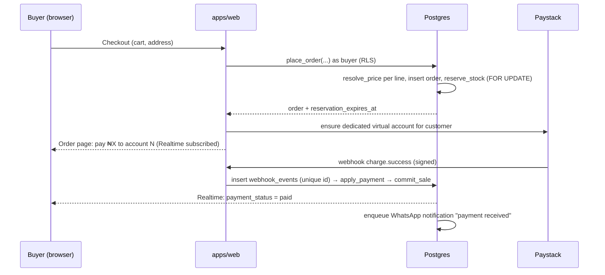

# Trawer — Architecture

Trawer is a wholesale-first commerce + inventory platform. One live stock count is shared by the
web storefront, WhatsApp, Instagram and an offline-capable POS. This document describes module
boundaries, the data model's invariants and how a sale flows through each channel.

## 1. System diagram



## 2. Module boundaries

| Module | Owns | Must not |
| --- | --- | --- |
| `packages/db` | SQL migrations (`supabase/migrations`), seed, generated TS types, DB test harness | contain app logic beyond SQL functions |
| `packages/core` | Pure domain logic: price resolver mirror, unit conversion, Zod schemas, money, WhatsApp bot state machine, POS sync engine, provider interfaces + adapters (Paystack, Meta, Termii, Anthropic) | import React/Next/Expo; touch the DB directly (talks through injected repositories) |
| `apps/web` | Storefront, dashboard, webhooks, POS sync API, cron endpoints | write stock or prices outside the SQL functions; ship the service key to the browser |
| `apps/pos` | Offline-first POS, multiple carts, receipts, cash-up, rider screen | trust its own stock as global truth (it only spends its *allocation*) |

### Data access (DAL)

The web server talks to Postgres directly through two helpers in `apps/web/src/server/db.ts`:

* `withUser(claims, fn)` — opens a transaction, `SET LOCAL ROLE authenticated` (or `anon`) and
  sets `request.jwt.claims` exactly like PostgREST does, so **every query is subject to RLS**.
  Claims come from the verified Supabase Auth JWT.
* `withService(fn)` — service role, used only by webhooks, cron and system jobs. It lives in a
  `server-only` module so it cannot be bundled into a client component.

This replaces PostgREST round-trips for server-rendered pages. Browser code never queries the DB.
Supabase Realtime is still used in the browser for live order/payment status (anon key, RLS-scoped).

## 3. Invariants (enforced in the database)

1. **Inventory is a ledger.** `stock_movements` is append-only. Every movement targets one bucket
   of `stock_levels`:

   | type | bucket | sign of `qty_delta` |
   | --- | --- | --- |
   | receive, return, transfer_in | on_hand | + |
   | sale, transfer_out | on_hand | − |
   | adjust | on_hand | ± |
   | reserve / release | reserved | + / − |
   | allocate / deallocate | allocated (device) | + / − |

   `available = on_hand − reserved − allocated` and a CHECK constraint keeps it `>= 0`, so an
   oversell is impossible even if a function has a bug. Only `SECURITY DEFINER` functions write
   these tables; `anon`/`authenticated` have no write grants. Replaying the ledger reproduces
   `stock_levels` exactly (covered by tests).
2. **Atomic reservation.** `reserve_stock`, `commit_sale` and `release_reservation` lock the
   `stock_levels` rows `FOR UPDATE` in a deterministic order (variant, location), so there are no
   deadlocks and no lost updates. Reservations expire via `expire_reservations()` (pg_cron, every
   minute; the timeout is per business).
3. **Prices.** `resolve_price(variant, customer, qty, channel)` is the only price source for
   orders. Resolution order: per-customer override → customer tier (tier-scoped volume break,
   else tier price; wholesale tiers only for *approved* wholesalers, at any quantity) → general
   volume break → retail price. Money is integer **kobo** everywhere. `packages/core` contains a
   byte-for-byte mirror for the offline POS, and a parity test runs both against the same fixtures.
4. **Units.** Stock and price are stored per base unit (piece). `product_units` holds packs
   (carton = N pieces). Order lines keep `unit_id`, `unit_qty` and the derived `base_qty`.
5. **Tenancy.** Every table has `business_id` (except global lookups and user-scoped consent
   rows). RLS is on for every table; a test fails if any table is missing RLS.

## 4. Sale data flow per channel

### Web storefront



### WhatsApp

1. Meta posts the inbound message to `/api/webhooks/whatsapp`. The `X-Hub-Signature-256` header is
   verified and the raw event is stored once in `webhook_events`.
2. The buyer is identified by phone → `customers` row, and `whatsapp_sessions.state` is loaded.
3. The pure bot state machine (`packages/core/whatsapp`) decides the replies. Prices are quoted by
   `resolve_price` for that customer, so a wholesaler sees the same tier price as on the web.
4. On "checkout": `place_order(channel = 'whatsapp')` reserves stock and the buyer gets their
   virtual account details. Payment follows the same webhook path as the web.

### Instagram (Phase 1)

Products are published from product settings (now or scheduled). A caption links to the
storefront product page, so the sale itself follows the web flow with `channel = 'instagram'`
(UTM/`?ch=ig`). DM ordering is Phase 2; `SocialProvider` and `orders.channel` already allow it.

### POS online

`place_order(channel = 'pos', device_id)` + `commit_sale` + `record_payment` run in one
transaction, the same as on the web, so stock is decremented immediately.

### POS offline

```mermaid
sequenceDiagram
  participant D as POS device (SQLite)
  participant W as /api/pos/sync
  participant DB as Postgres
  Note over D,DB: While online: manager allocates N units per variant to the device (allocate movement)
  D->>D: Offline sale draws from local allocation, client_id = uuid
  D->>W: push outbox [sale(client_id, lines, payments)]
  W->>DB: sync_pos_sale(device, payload) (idempotent on client_id)
  DB->>DB: deallocate+sale from device allocation; shortfall → take from available; still short → stock_alert, never negative
  DB-->>W: result per sale (applied | duplicate | conflict)
  W-->>D: ack + fresh allocations, prices, catalogue delta
```

## 5. Background jobs

| Job | Schedule | Implementation |
| --- | --- | --- |
| Expire reservations | every minute | `pg_cron` → `expire_reservations()` |
| Social post scheduler | every minute | `pg_cron` + `pg_net` → `POST /api/cron/social` (or Vercel Cron) → `claim_due_social_posts` (`SKIP LOCKED`) → `SocialProvider` |
| Notification outbox | every minute + on demand | `/api/cron/notifications` drains `notifications` (WhatsApp) |
| Debt reminders | daily 09:00 WAT | `/api/cron/debt-reminders` enqueues template messages |
| Retention purge | daily | `apply_retention_policy()` |

## 6. Security model

* Buyers: Supabase phone OTP (Termii SMS provider). No passwords.
* Staff: phone OTP + TOTP (Supabase MFA). Pricing, staff and payout changes need an `aal2` JWT.
  The database checks this (`app.require_aal2()`), not just the UI.
* Permissions: `roles_permissions` (per-business overrides on top of defaults) checked by
  `app.has_permission(business_id, perm)` inside RLS policies and functions.
* Secrets: Meta and Paystack tokens live in Supabase Vault and are only read by service-role code.
* Webhooks: signatures are verified (HMAC-SHA512 for Paystack, HMAC-SHA256 for Meta), raw events
  are stored with a unique `(provider, event_id)`, and each is processed once.
* Rate limits: `app.rate_limit(key, max, window)` is used by the OTP request, sign-up and
  checkout paths.
* PII: never in URLs (tracking pages use 128-bit random tokens) and scrubbed from logs/Sentry.

## 7. Designed-for, not built (Phase 2+)

Kept open in the schema and interfaces: `stock_movements.type` already has `transfer_in` and
`transfer_out` (multi-warehouse), `orders.channel` takes any `sales_channel` enum value
(marketplaces), `SocialProvider` has DM hooks, `PaymentProvider` lets Monnify be added, and
`customers` keeps `credit_limit` (trade credit).
